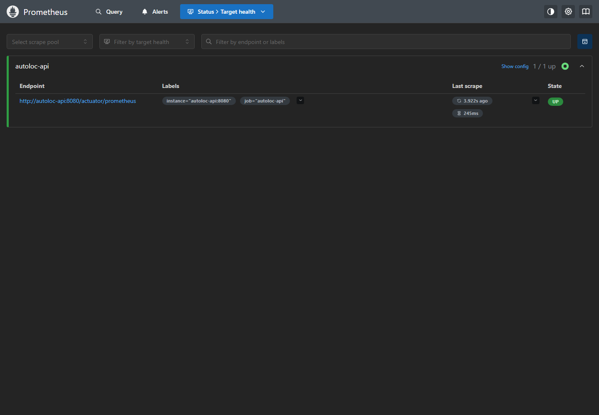

# AutoLoc — Monitoring V2 (Task 10)

## Composants

- Spring Boot Actuator expose `health` et `prometheus`.
- Micrometer publie les métriques JVM et HTTP au format Prometheus, avec histogrammes
  activés sur `http.server.requests` pour le calcul du percentile p95 côté Prometheus.
- Prometheus collecte l'API toutes les 15 secondes.
- Grafana est fourni par Docker Compose sur le port hôte `3001` ; il charge
  automatiquement la source de données Prometheus et le dashboard AutoLoc au
  démarrage via le mécanisme de provisioning de Grafana.

## Provisioning Grafana (V2)

```
monitoring/
├── prometheus.yml                                   # config Prometheus (inchangé)
└── grafana/
    ├── provisioning/
    │   ├── datasources/prometheus.yml               # source Prometheus (uid: autoloc-prometheus)
    │   └── dashboards/dashboard.yml                 # provider fichiers → /etc/grafana/dashboards
    └── dashboards/
        └── autoloc.json                             # dashboard AutoLoc API
```

Les deux répertoires sont montés en lecture seule dans le conteneur Grafana via
`docker-compose.yml`.

## Dashboard AutoLoc API

Six panneaux time-series disponibles après démarrage :

| Panneau | Métrique principale | Unité |
|---|---|---|
| JVM Heap Memory | `jvm_memory_used/max_bytes{area="heap"}` | bytes |
| CPU Usage | `process_cpu_usage`, `system_cpu_usage` | % |
| HTTP Request Rate | `rate(http_server_requests_seconds_count[1m])` | req/s |
| HTTP Latency p50/p95 | `histogram_quantile(0.95, …_bucket[5m])` | s |
| JVM Live Threads | `jvm_threads_live_threads`, `_daemon_threads` | count |
| HTTP Traffic by URI | `sum by (uri,method,status) (rate(…_count[1m]))` | req/s |

Le panneau *HTTP Traffic by URI* permet de visualiser en temps réel les appels
effectués depuis Postman par endpoint, méthode et statut HTTP.

## Sécurité et secrets

Seuls `/actuator/health` et `/actuator/prometheus` sont publics. Les autres
routes `/api/**` conservent les règles HTTP Basic de TASK-08. Les mots de passe
MySQL et Grafana sont fournis par `MYSQL_ROOT_PASSWORD` et
`GRAFANA_ADMIN_PASSWORD` ; ils ne sont pas enregistrés dans le dépôt.

## Démarrage

```powershell
$env:MYSQL_ROOT_PASSWORD = '<mot-de-passe-local>'
$env:GRAFANA_ADMIN_PASSWORD = '<mot-de-passe-local>'
docker compose up --build -d
```

Endpoints par défaut :

- `http://127.0.0.1:8080/actuator/health`
- `http://127.0.0.1:8080/actuator/prometheus`
- `http://127.0.0.1:9090/targets`
- `http://127.0.0.1:3001` → dashboard *AutoLoc API* provisionné automatiquement

Arrêt :

```powershell
docker compose down
```

## Capture du dashboard

> **À compléter après démarrage de la stack.**
> Lancer `docker compose up --build -d`, attendre ~30 s, ouvrir
> `http://127.0.0.1:3001`, puis aller dans *Dashboards → AutoLoc API*.
> Envoyer quelques requêtes depuis Postman pour alimenter les métriques HTTP,
> faire une capture d'écran réelle et la sauvegarder sous `docs/grafana-dashboard.png`.

## Validation réelle du 27 novembre 2026 (V1)

La collecte a été testée avec des ports hôtes alternatifs pour cohabiter avec
les services locaux existants : API `8081`, Prometheus `9091` et MySQL `3307`.

Résultats V1 :

- Actuator health : `UP`
- `/actuator/prometheus` : HTTP `200`
- métriques JVM présentes : oui
- cible Prometheus `autoloc-api` : `UP`
- erreur du dernier scrape : aucune
- tests Maven : 8 réussis, 0 échec, 0 erreur


