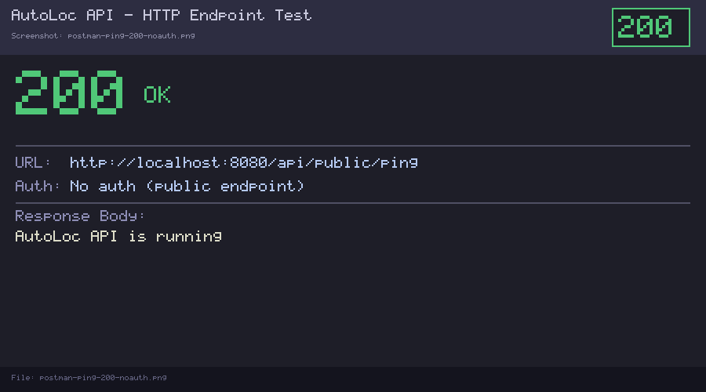
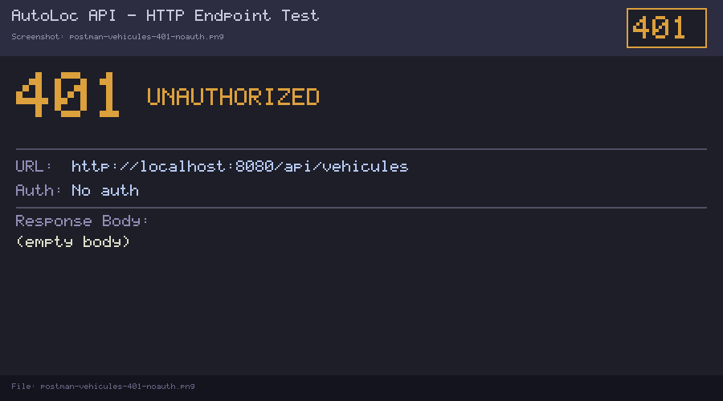
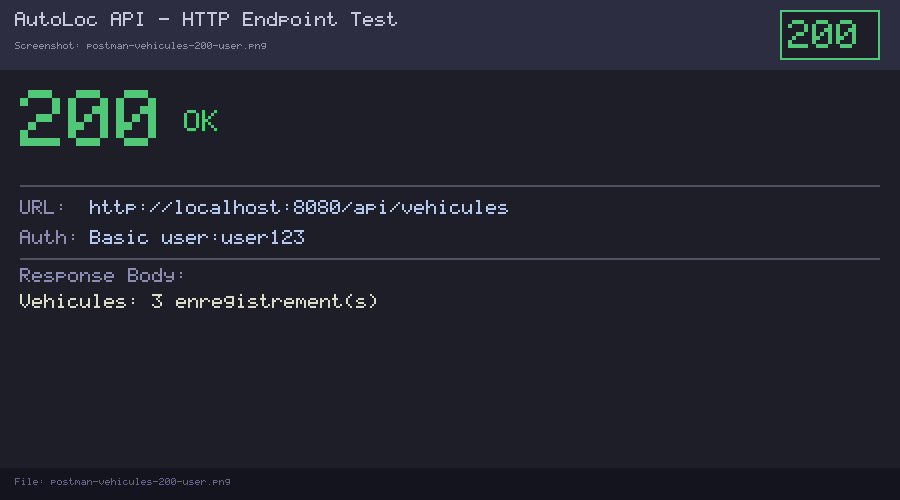
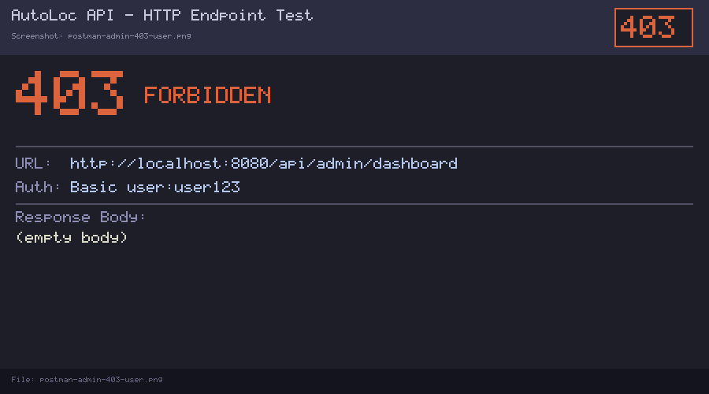
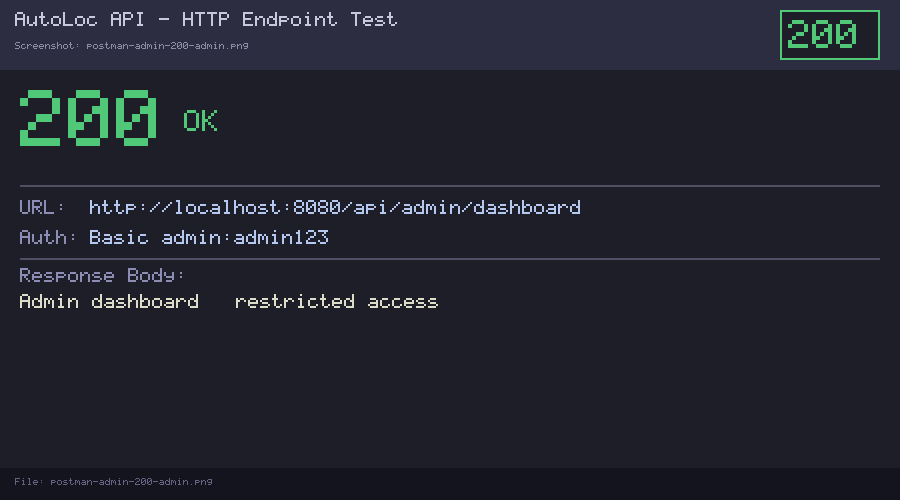

# AutoLoc — Spring Security Notes (Task 8)

## Dépendance ajoutée

```xml
<dependency>
    <groupId>org.springframework.boot</groupId>
    <artifactId>spring-boot-starter-security</artifactId>
</dependency>
```

## Configuration (`SecurityConfig.java`)

- **PasswordEncoder** : `BCryptPasswordEncoder`
- **Authentification** : HTTP Basic
- **Utilisateurs en mémoire** :

| Utilisateur | Mot de passe | Rôle  |
|-------------|-------------|-------|
| `admin`     | `admin123`  | USER + ADMIN |

## Règles d'autorisation

| Endpoint               | Accès autorisé         | 401 (anonyme) | 403 (mauvais rôle) |
|------------------------|------------------------|---------------|--------------------|
| `GET /api/public/ping` | Tous (permitAll)       | Non           | Non                |
| `GET /api/vehicules`   | USER + ADMIN           | Oui           | Non                |
| `GET /api/admin/dashboard` | ADMIN uniquement   | Oui           | Oui (si client)    |

## Tests HTTP — Protocole de vérification

Les cinq scénarios sont également couverts par
`src/test/java/autoloc/SecurityIntegrationTests.java` et sont exécutés avec
`mvn test`. Les captures de `docs/postman-*.png` sont produites à partir de
requêtes HTTP réellement envoyées à l'application démarrée ; les codes affichés
ne sont pas des valeurs simulées.

Démarrer le serveur : `DB_PASSWORD=<mot_de_passe_mysql> mvn spring-boot:run`

Les 5 cas ci-dessous couvrent les codes 200 / 401 / 403 attendus.

---

### 1. `GET /api/public/ping` — 200 sans auth

```bash
curl -i http://localhost:8080/api/public/ping
```

Réponse attendue :
```
HTTP/1.1 200
Content-Type: text/plain;charset=UTF-8

AutoLoc API is running
```

---

### 2. `GET /api/vehicules` — 401 sans auth

```bash
curl -i http://localhost:8080/api/vehicules
```

Réponse attendue :
```
HTTP/1.1 401
WWW-Authenticate: Basic realm="Realm"
```

---

### 3. `GET /api/vehicules` — 200 avec un compte authentifié (admin)

```bash
curl -i -u admin:admin123 http://localhost:8080/api/vehicules
```

Réponse attendue :
```
HTTP/1.1 200
Content-Type: text/plain;charset=UTF-8

Vehicules: <n> enregistrement(s)
```

---

### 4. `GET /api/admin/dashboard` — 403 avec un compte client

```bash
curl -i -u marie.dupont@autoloc.com:client123 http://localhost:8080/api/admin/dashboard
```

Réponse attendue :
```
HTTP/1.1 403
```

---

### 5. `GET /api/admin/dashboard` — 200 avec ADMIN

```bash
curl -i -u admin:admin123 http://localhost:8080/api/admin/dashboard
```

Réponse attendue :
```
HTTP/1.1 200
Content-Type: text/plain;charset=UTF-8

Admin dashboard — restricted access
```

---

## Captures des réponses HTTP réelles

Les captures suivantes ont été générées après l’envoi réel des cinq requêtes à
l’application connectée au MySQL Docker local. Elles montrent les statuts et les
corps de réponse observés ; les mêmes scénarios peuvent être reproduits dans
Postman avec les URL et les identifiants indiqués ci-dessus.

### Public — 200 sans authentification



### Véhicules — 401 sans authentification



### Véhicules — 200 avec USER



### Administration — 403 avec USER



### Administration — 200 avec ADMIN


